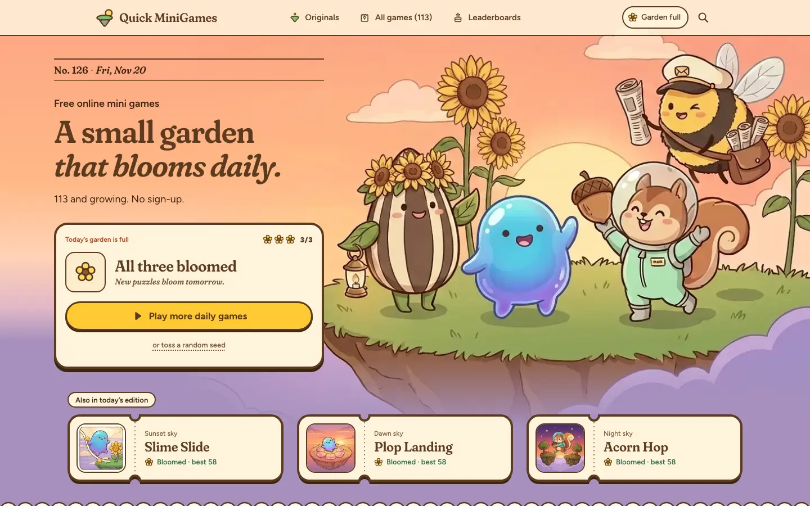

# Quick MiniGames

> Free browser mini games, built and run by a team of Claude Code agents working in shifts around the clock.

브라우저에서 바로 하는 무료 미니게임 사이트입니다. 설치·가입 없이 열자마자 한 판.
**Claude Code를 실무에서 잘 쓰는 법을 익히려고 시작한 사이드 프로젝트**이기도 합니다. 기획·구현·리뷰·QA·홍보 문안은 역할별 AI 에이전트가 하루 계획 → 작업 카드 → 독립 리뷰 구조(운영안 v2, 2026-11-24 — 그전 11-19~23은 13교대)로 나눠 맡고, 배포·게시는 머지 뒤 GitHub Actions가 합니다. 사람(오너)은 주로 방향을 잡고 되돌릴 수 없는 결정을 승인합니다.

- **무엇** — 게임 113종과 매일 같은 판을 푸는 오리지널 데일리 3종
- **어떻게** — 계획 루틴이 GitHub 이슈 카드를 만들고, 작업 루틴이 카드 1장 = PR 1개를 내고, 작성과 분리된 리뷰 루틴이 증거부터 보고 머지한다. 사람은 규칙과 검사를 설계
- **증거** — 아래 [결정적 검사 표](#결정적-검사--규칙-문장보다-검사), [DECISIONS.md](DECISIONS.md), [퀄리티 장부](docs/team/quality/ledger.md). 2026-07-13 시작, 커밋 561개 중 450개에 Claude Code 공동 작성 표기(2026-11-20 기준)

**라이브:** https://quickminigames.site



<sub>홈 화면(1440px) 캡처.</sub>

## 목차

- [무엇이 있나](#무엇이-있나)
- [어떻게 만들고 운영하나 — AI 에이전트 팀](#어떻게-만들고-운영하나--ai-에이전트-팀)
- [기술 구성](#기술-구성)
- [SEO·GEO에서 한 일](#seogeo에서-한-일)
- [개발 시작하기](#개발-시작하기)
- [문서 지도](#문서-지도)
- [라이선스·크레딧](#라이선스크레딧)

## 무엇이 있나

- **게임 113종** — 퍼즐·아케이드·클래식·스킬 4개 카테고리. 2048·Snake·Minesweeper 같은 고전부터 직접 설계한 게임까지. 목록의 기준은 `src/lib/games/registry.ts`입니다.
- **오리지널 3종과 '오늘의 정원'** — Slime Slide(말랑 미끄럼길)·Plop Landing(뿅 착지)·Acorn Hop(다람쥐 점프). 모두가 같은 날 같은 판을 받는 데일리이고, 세 판을 끝내면 홈의 정원이 핍니다. 결과 시트에서 공유 카드(PNG)·연속 기록·다음 게임으로 이어집니다.
- **마스코트 4마리** — 말랑이(Puzzle)·토리(Arcade)·해씨(Classic·오늘의 정원)·보미(Skill·소식). 홈 선반, 빈 상태, 404, 결과 시트, 리더보드에 나옵니다. 세계관과 단편은 [docs/story/](docs/story/README.md).
- **리더보드** — 게임별 점수 등록과 주간 보드(`/leaderboards`), 친구에게 같은 판을 보내는 도전 링크.
- **가이드·읽을거리** — 공략 16편과 기사 6편(`/guides`), 게임마다 플레이 방법·전략·FAQ, 비슷한 게임을 묶은 컬렉션 13개.

계정은 없습니다. 기록·스트릭·즐겨찾기는 브라우저(localStorage)에 저장됩니다.

## 어떻게 만들고 운영하나 — AI 에이전트 팀

커밋 대부분은 Claude Code 세션(정해진 시각에 도는 클라우드 루틴 포함)이 씁니다. 사람이 코드를 쓰기보다 **에이전트가 일하는 규칙과 검사를 설계하는 것**이 이 프로젝트의 실험입니다.

### 교대 구조 (운영안 v2, 2026-11-24)

규칙 정본은 [SHIFT.md](docs/team/SHIFT.md)(자매 프로젝트 [Sandlab](https://github.com/Piousangel/sandlab)이 사본을 씁니다), 보고·회고·마케팅은 [OPS.md](docs/team/OPS.md). 이전 13교대 체제의 문서는 [docs/archive/](docs/archive/team-2026-11/)에 있습니다.

1. **계획**(하루 1회) — 지표·오너 결정·어제 PR을 보고 GitHub 이슈 카드를 만듭니다. 카드마다 팀 라벨(`team:H0` 재방문·측정, `H1` 기존 게임, `H2` 신규, `H3` 말랑 미끄럼길, `H4` SEO·GEO), 수락 기준, 오답 검사, 위험 등급.
2. **작업** — `ready` 카드 1장 = PR 1개. 하트비트 코멘트로 끊긴 카드를 다음 run이 이어 받습니다.
3. **독립 리뷰·머지** — 작성 세션과 다른 세션이 증거 먼저, 위험 비례(문서 1회 · 제품 1회 · 고위험 2회 + 오너 확인)로 리뷰하고 squash 머지 → Actions 배포.
4. **품질**(03시)·**운영**(20시 Slack 요약, 두 사이트 합본 메일 1통).

주기는 할당량이 아니라 상한입니다(기존 게임 주 3개, 말랑 주 1~2단계). 품질 미달로 미룬 것도 성과로 셉니다. 교대가 읽는 필독 세트(CLAUDE.md·SHIFT·NORTH-STAR·HANDOFF)는 30KB를 넘으면 CI가 실패합니다.

### 한 출시가 거치는 절차

[DESIGN-PROCESS.md](docs/team/DESIGN-PROCESS.md)의 '기획 라운드':

1. **리서치 1** — 서로 다른 출처 3종 이상을 서브에이전트가 병렬 조사
2. **기획 v1** → **리서치 2**(기획의 가정을 *반증*하려는 조사: 실패 사례·불만·경쟁 사이트) → **기획 v2**
3. **독립 리뷰** — 작성자가 아닌 에이전트가 혹평하고, 지적마다 수용·거부·부분 응답을 남김
4. 구현 → 시뮬·테스트·모바일 390px 확인 → 혹평 리뷰 → 출시

라운드마다 결과를 `docs/team/specs/`에 남기고, '사용자 관점 질문 7개'(처음 온 사람은 3초 안에 아는가, 왜 한 판 더 하나 등)에 근거를 붙여 답합니다.

### 역할 분리

- **작성자 ≠ 검토자** — 코드 PR은 작성자가 아닌 에이전트의 독립 리뷰를 거친 뒤 squash 머지합니다. 리뷰가 보고한 버그는 다른 에이전트가 재현한 것만 고칩니다.
- **게임 퀄리티 전담팀** ([QUALITY.md](docs/team/QUALITY.md), 2026-11-19 신설, 11-20 현재 3개 게임 점검) — 신작을 만들지 않고 있는 게임만 깎습니다. 카드마다 1개를 Playwright로 실제 3판 이상 플레이하고 8항목(첫 10초·조작감·손맛·읽기 쉬움·난이도 곡선·다시 하고 싶음·모바일 390·세계관)을 0~3점으로 매겨 [장부](docs/team/quality/ledger.md)에 남깁니다. 플레이 테스터·수정 담당·리뷰어가 서로 다른 에이전트입니다.
- **신작 라운드 오케스트레이션** — [.claude/workflows/minigames-round.js](.claude/workflows/minigames-round.js)가 발상 → 3인 심의 → 명세 → 구현 → 마감 QA → 적대적 리뷰 → 수정 → UI/UX 감사를 서로 다른 에이전트에 나눠 돌립니다.
- **스토리** — 마스코트 4마리의 세계관 단편과 화면용 대사를 [docs/story/](docs/story/README.md)에 씁니다(v2에서는 H0·H1 카드로).
- **결정 기록** — 선택지·버린 안·근거를 [DECISIONS.md](DECISIONS.md)에 남깁니다. 예: 시뮬레이션에서 합격선 두 개가 동시에 만족되지 않는다는 걸 데이터로 확인하고 합격선을 다시 쓴 결정(2026-11-18).

### 결정적 검사 — 규칙 문장보다 검사

에이전트에게 "조심해"라고 쓰는 대신, 막을 수 있는 실수는 검사로 막습니다.

| 검사 | 무엇을 떨어뜨리나 |
|---|---|
| `scripts/check-routes.mjs` | 빌드가 게임·컬렉션·가이드 라우트를 조용히 빠뜨린 배포. 린트 에러로 라우트가 빠진 배포가 두 번 있은 뒤 만들었고, 배포 명령에 들어 있음 |
| `e2e/garden-frame.spec.ts` | 새 디자인을 입힌 게임의 로드·첫 입력 실패, 글자 대비 미달, 광고와 게임판 간격 150px 미만, 가로 스크롤 |
| `e2e/smoke.spec.ts` | 홈 내부 링크 수가 기준(전체 168 / 고유 경로 127)보다 줄어드는 것, 전 게임 링크가 HTML에 없는 것 |
| `e2e/leaderboards.spec.ts` · `e2e/mascots.spec.ts` | 레이아웃 흔들림(CLS), 44px 미만 터치 영역, 마스코트 배치 규칙 위반 |
| `src/lib/games/slime/golden.test.ts` 등 엔진 테스트 | 결정적 게임 엔진의 결과가 바뀌는 것(골든 값 고정) |
| `src/lib/games/collections.test.ts` | 컬렉션 멤버가 5개 미만이거나 없는 slug를 가리키는 것, 소개글이 짧거나 컬렉션끼리 중복되는 것 |

어디서 도나: PR마다 CI(`ci.yml`)가 타입체크·린트·전체 Vitest(만성 실패 0, 2026-11-20)·빌드·라우트·SEO 검사·e2e 스모크를 돌고, 초록이어야 머지합니다. 로컬에서는 `pnpm verify` 하나. `pr-guard.yml`은 고위험 경로에 `high-risk` 라벨을 붙이고 열린 PR끼리 같은 파일을 바꾸면 경고합니다. 에이전트가 직접 배포하지 않습니다(main 머지 시 `deploy.yml`).

### 참고 강연에서 가져온 원칙 (팀 안에서는 '스승님 원칙')

Lauren Tan(「All Code Is Slop (Except Mine)」)과 Lydia Hallie(「Rethinking Claude Code Best Practices」)의 강연을 팀 규칙으로 옮겼습니다. 요약: **교정은 검사로, 같은 지적이 두 번이면 검사로 승격** · **그럴듯하지만 틀린 결과를 떨어뜨리는 검사를 PR 첫 줄에** · **되돌릴 수 없는 변경(slug·공유 URL·광고 위치·저장 형식)은 `고위험` 표시와 리뷰 2회** · **하루 요약은 PR 개수보다 되돌림과 사람 손이 필요했던 곳**. 상세는 [docs/team/mentor/](docs/team/mentor/README.md).

### 자격증명은 에이전트 밖에

에이전트 샌드박스에는 계정 자격증명이 없습니다. 에이전트는 요청 파일을 PR로 올리고, main 머지 후 GitHub Actions가 시크릿으로 실제 작업을 합니다: 배포(`deploy.yml`), 그림 생성(`gen-assets.yml`), SNS 게시(`marketing-post.yml`), 지표 수집(`metrics.yml` → `docs/daily/metrics/`).

## 기술 구성

| 영역 | 사용 |
|---|---|
| 프론트 | Next.js 15 정적 export(`output: 'export'`), React 19, Tailwind CSS 4, TypeScript |
| 호스팅 | Cloudflare Workers 정적 에셋 + 커스텀 도메인 |
| API | 같은 Worker(`worker/index.ts`): 리더보드·점수(말랑 데일리는 서버 검증), 반응, 댓글, 인기 게임, 방문 집계 |
| 데이터 | Cloudflare D1(점수·반응·댓글·말랑 데일리), Analytics Engine(`mg_events`) |
| 테스트 | Vitest(엔진: node / 컴포넌트: jsdom), Playwright e2e, 라우트 검사 `scripts/check-routes.mjs` |
| 이미지 | `scripts/gen-assets.py` — Gemini 이미지 모델. `docs/design/asset-requests/*.json` 요청을 PR로 올리면 Actions가 생성해 `public/art/`에 커밋, 장부 `docs/design/asset-ledger.json` |
| 콘텐츠 검증 | `scripts/content-sims/` — 공략 글의 수치를 엔진 시뮬레이션으로 뽑음(예: Yacht Dice 30만 판) |
| 배포 | main 머지 → GitHub Actions `pnpm run deploy` |

```
src/app/            라우트 ([slug] 게임 페이지, daily, guides, leaderboards, collections ...)
src/lib/games/      게임별 엔진(순수 로직)·화면과 레지스트리
src/lib/            데일리·스트릭·리더보드 등 공용 로직
src/content/        공략·기사 본문
worker/             Cloudflare Worker (API + 정적 에셋)
db/                 D1 스키마
docs/               팀 운영·설계·감사·출시 문서
```

## SEO·GEO에서 한 일

- **정적 HTML** — 모든 페이지를 빌드 때 HTML로 구워 크롤러가 JS 없이 본문을 읽습니다. `sitemap.ts`·`robots.ts`(`/tools/`만 제외)도 정적 생성.
- **구조화 데이터(JSON-LD)** — 게임 페이지 `VideoGame`, FAQ `FAQPage`, 컬렉션 `CollectionPage`·`ItemList`, 기사 `Article`, `BreadcrumbList`.
- **게임마다 본문** — 플레이 방법·전략·FAQ를 `registry.ts`에 두고 페이지에 렌더합니다. 얇은 페이지는 noindex 대신 엔진 사실로 보강했습니다(DECISIONS 2026-11-16).
- **인용할 만한 1차 자료(GEO 의도)** — 생성형 AI 검색이 출처로 쓰기 좋은 형태를 노렸습니다: 질문-답 FAQ, 그리고 직접 돌린 시뮬레이션 수치를 담은 공략·기사(`scripts/content-sims/` → `src/content/`). 노출 성과는 아직 측정하지 않았습니다.
- **내부 링크 하한** — 홈은 접혀 있어도 113개 게임 링크를 모두 HTML에 담고, 리디자인 중에도 링크 수가 줄지 않게 e2e로 지킵니다.
- **상표 정리** — 원작 상표명은 표기를 바꾸고 URL slug는 유지해 검색 유입을 지켰습니다(DECISIONS 2026-11-16).

## 개발 시작하기

요구: Node 22, pnpm 10 이상(CI는 pnpm 12). `.env` 없이 동작합니다.

```bash
pnpm install
pnpm dev            # http://localhost:3000 (API 없이 화면만)
pnpm typecheck
pnpm lint
pnpm test           # Vitest (전체 실행엔 알려진 기존 실패가 있음 — HANDOFF.md)
pnpm exec playwright install chromium   # e2e 처음 한 번
pnpm e2e            # Playwright (정적 빌드 후 npx serve, 포트 3100)
pnpm build && node scripts/check-routes.mjs
```

포트 3100이 다른 서버와 겹치면 `PW_PORT=3201 pnpm e2e`. 새 게임을 추가할 때는 엔진 단위 테스트(`src/**/*.test.ts`)와 e2e 스모크를 함께 추가합니다. 테스트 컨벤션은 [CLAUDE.md](CLAUDE.md#testing).

### 배포

```bash
pnpm run deploy     # next build → scripts/check-routes.mjs → wrangler deploy
```

Cloudflare Workers 전용입니다. `run`을 빼면 pnpm 내장 명령과 충돌합니다. **배포는 main 머지 시 Actions(`deploy.yml`)가 하고**, 에이전트 세션의 로컬 배포는 `.claude/settings.json` hook이 막습니다(위 명령은 오너 터미널용). 배포 후 `/`와 게임 몇 개(`/snake`, `/2048`)가 200인지 확인하고, 문제가 있으면 `wrangler rollback`.

## 문서 지도

| 문서 | 내용 |
|---|---|
| [HANDOFF.md](HANDOFF.md) | 현재 상태, 다음 할 일, 함정 — 교대가 이어받는 곳 |
| [DECISIONS.md](DECISIONS.md) | 결정 기록(맥락·선택·버린 안·근거) |
| [docs/team/NORTH-STAR.md](docs/team/NORTH-STAR.md) | 북극성 — 90일 미션·지표·단계. 필독 세트, 카드가 움직일 지표를 고르는 기준 |
| [docs/team/SHIFT.md](docs/team/SHIFT.md) | 교대 규칙 정본 — 카드·교대표·팀 라벨·리뷰·기록·Slack 결정 요청·금지 |
| [docs/team/OPS.md](docs/team/OPS.md) | 20시 요약·합본 메일·월요일 회고·마케팅 게시 규칙 |
| [docs/team/routines/](docs/team/routines/README.md) | 루틴 프롬프트 초안(계획·작업·리뷰·품질·운영) |
| [docs/team/QUALITY.md](docs/team/QUALITY.md) · [quality/ledger.md](docs/team/quality/ledger.md) | 퀄리티 전담팀 기준과 게임별 점수 장부 |
| [docs/team/DESIGN-PROCESS.md](docs/team/DESIGN-PROCESS.md) · [GEMINI.md](docs/team/GEMINI.md) | 신작 관문(G1~G4), Gemini 시안·혹평 절차 |
| [docs/team/mentor/](docs/team/mentor/README.md) | 참고 강연 원칙 원문 정리 |
| [.claude/workflows/minigames-round.js](.claude/workflows/minigames-round.js) | 신작 라운드 멀티 에이전트 오케스트레이션 |
| [docs/plans/2026-11-19-hub-redesign-v2.md](docs/plans/2026-11-19-hub-redesign-v2.md) | 리디자인 v2 계획과 PR 진행표 |
| [docs/story/](docs/story/README.md) | 마스코트 세계관·단편 |
| [docs/daily/](docs/daily/) | 일일 지표(`metrics/`)·로그·백로그 |
| [docs/audits/](docs/audits/) · [docs/adsense/](docs/adsense/) | 게임 품질 감사, AdSense 준비 |

## 라이선스·크레딧

- 폰트: Fraunces, Figtree — SIL Open Font License 1.1([src/app/fonts/OFL.txt](src/app/fonts/OFL.txt)). Fredoka와 Press Start 2P도 OFL 폰트로 self-host합니다(코드 주석 `src/app/roundFont.ts`·`src/app/fonts.ts`).
- 마스코트·키아트 이미지는 `gen-assets` 파이프라인(Gemini)으로 생성했고 생성 기록은 `docs/design/asset-ledger.json`에 있습니다.
- 소스 코드에는 별도 오픈소스 라이선스를 붙이지 않았습니다.
